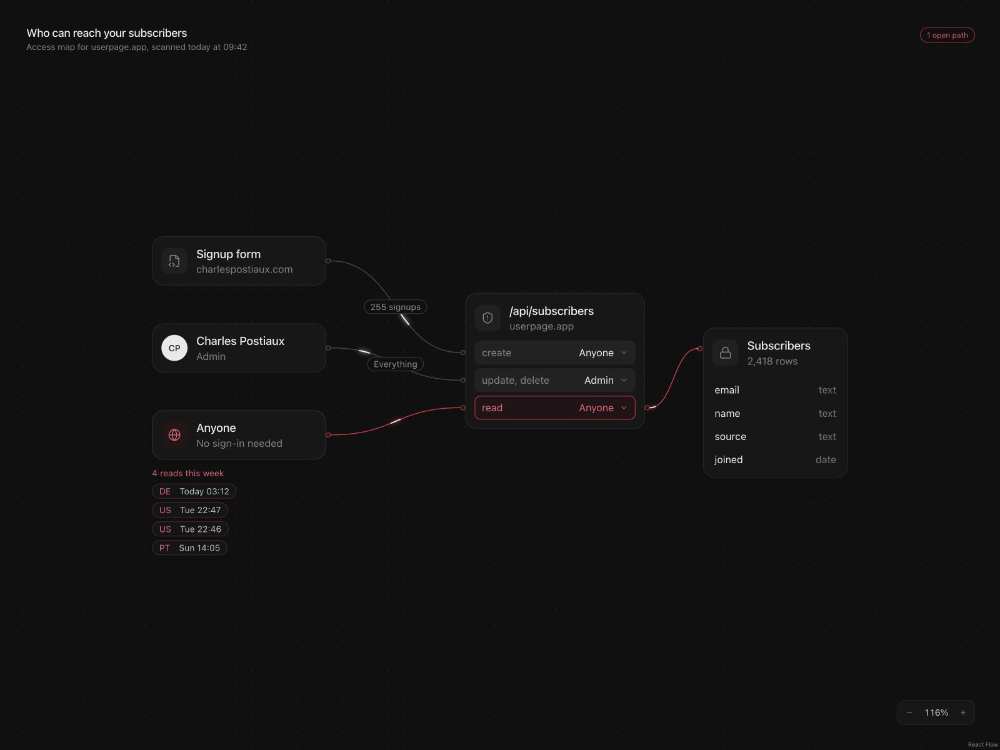

# Access Map UI

Interactive permissions-map components built with React, shadcn/ui, Motion, and React Flow.



Interactive component study of [Charles Postiaux’s reference on Collect UI](https://collectui.com/designs/ai-flow-ui-design-inspiration/19701b08-8230-4df7-9d93-d01e1b3b7293).

## Run

Use Node.js 24 or newer.

```sh
git clone https://github.com/vhicktour/access-map-ui.git
cd access-map-ui
npm ci
npm run dev -- --host 127.0.0.1 --port 4173
```

Open http://127.0.0.1:4173/ locally. `npm test` runs six permission-state tests. `npm run build` creates the static build.

## Components

- `src/components/access-map.jsx`: graph, header, saved state, and zoom controls.
- `src/components/map-nodes.jsx`: actor, API, table, and read-activity components.
- `src/components/permission-row.jsx`: accessible draft selection and save popover.
- `src/components/connection-edge.jsx`: curved connectors and traveling highlights.
- `src/components/ui/`: genuine shadcn base-nova Card, Button, and Popover source.
- `src/permissions.js`: role options, rule validation, and public-read status.
- `src/styles.css`: reference colors, spacing, typography, and mobile behavior.

The demo uses React, Motion through `motion/react` (the current Framer Motion API), shadcn/ui with Base UI, Lucide, Tailwind CSS, and React Flow. React Flow handles dragging, ports, curves, and zoom. Motion animates the edge highlights, popover, and status transitions.

## Behavior

Open the red read row, choose Admin, and save. The public edge becomes dashed and the warning clears. Reopen and save Anyone to restore it. Draft changes stay separate from the saved rule; Escape cancels. Cards can be dragged while connections follow them. The percentage control resets zoom.

The source video demonstrates desktop behavior. The horizontally scrollable mobile canvas is a proposed adaptation. Traveling highlights are disabled for reduced motion.

This is a local component demo. Rules use React state and reset on refresh; there is no backend or live security scan.

## Design prompt and evidence

The detailed [Claude Design prompt](docs/claude-design-prompt.md) describes the component anatomy and interactions. Use the original Collect UI URL for visual grounding. The original video and source frames are not included.

Exact original font files and animation timing are unavailable. Colors, geometry, and timing are tuned estimates. The build succeeds with a bundle-size advisory from Vite; production integration could reduce the initial graph bundle.

## Checks

```sh
npm test
npm run build
npm run test:sites
npm run format:check
npm audit --audit-level=high
```

GitHub Actions runs these checks on pushes and pull requests. Hosting tests cover asset serving and generated build files. Static files are built into `dist/client/`; the same build also emits optional Sites hosting files.

## Contributing

Open an issue for a bug or proposed change. Keep pull requests focused, run the checks above, and put tests in `tests/`. Do not commit dependencies, generated builds, or credentials.

## License

[MIT](LICENSE). See [third-party notices](THIRD_PARTY_NOTICES.md) for shadcn/ui attribution and visual-reference credits.
